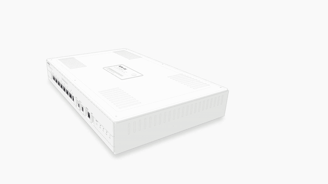

# network-switch-anatomy

An 8-port gigabit network switch drawn as a crafted machine instead of a diagram: real board density, a working
MAC-learning crossbar, an exploding stack of parts. One self-contained HTML file, no server, works offline.

### [Live demo: https://hsiang-tang.github.io/network-switch-anatomy/](https://hsiang-tang.github.io/network-switch-anatomy/)

[](https://hsiang-tang.github.io/network-switch-anatomy/film.html)

**Watch the film with music** (49 s): https://hsiang-tang.github.io/network-switch-anatomy/film.html (or click the
animation above). Full 1080p60 version: [Release](../../releases/latest)

## What to try

- Click a port (or press 1-8) to send a frame: watch it run to the crossbar, get filed in the MAC-table drawers and
  forwarded (or flooded).
- Press **L** to open or close the lid.
- Press **E** (or Explode) to lift the layers apart, then single parts, then reassemble.
- Click any chip, connector, fan or the supply to zoom in and open its pin-out sheet; **Parts** lists every part.

Built on the [anatomy](https://github.com/wheresryan22/anatomy) isometric kit (MIT, vendored in `vendor/anatomy`).

## How this was built

- **Owner decisions:** scope (one 8-port switch that really learns and forwards), real-world scale (one unit is about
  0.85 mm), the look (white paper, ink lines, one orange accent), and acceptance for each revision, reviewed visually
  through eight iterations (see [Iteration history](#iteration-history)).
- **AI agents** wrote the generator code in `src/` and the film pipeline in `film/`, working against that feedback.
- **Verification:** `npm run build` regenerates `index.html` from source; each revision was checked by reviewing the
  built views (closed, open, exploded, light and dark, phone width), the browser console, frame rate, and sampled
  part transforms during explode and assemble.
- **What was hard:** the kit only knows orthographic projection, which made a box seen straight on look wrong, so a
  modified copy of the kit got a true pinhole perspective camera (and the glow shader inverts the same camera). Real
  board density, about 3000 traces, made the WebGL glow layer drop to 24 fps until each trace was skipped outside its
  bounding box (60 fps after).

## Where things go

| Path | Holds |
| --- | --- |
| `index.html` | The shipped demo (generated, self-contained) |
| `film.html` | Page with the film player (sound on), served by GitHub Pages |
| `src/` | Scene, board, enclosure and page scripts; `node src/build-all.mjs` regenerates `index.html` |
| `vendor/anatomy/` | The parts of the anatomy kit the build needs, with its MIT license |
| `media/` | The film (1080p30), a sub-10 MB embed copy, its poster and the README preview animation |
| `film/` | Frame-by-frame film director (`render.mjs`), camera shots, synthesised score (`music.py`), `mux.sh` |
| `.render/` | Ignored: shot frames and intermediate files |

## Build

```
npm install
npm run build        # regenerates index.html
npm run shots && npm run film   # needs Google Chrome and ffmpeg; writes network-switch-anatomy.mp4
```

## Film

`index.html#film` turns the animation loop off and exposes `window.film` (`step(dt)`, `cam2`, `send`, `lid`, `level`,
`part`, `list`). `film/render.mjs` advances the page 1/60 s per frame in headless Chrome, screenshots it, encodes each of
three shots with ffmpeg and cross-dissolves them. Camera paths are cubic-Hermite keyframes, so velocity is continuous.
The opening dollies in while the lid is already sliding off, so the first seconds read as motion. The score is
synthesised from scratch by `film/music.py` (no samples, no third-party music) and mixed in by `film/mux.sh`.
`media/` holds a 1080p30 copy for viewing; the full 1080p60 master (about 115 MB) is attached to Releases and is not stored in Git.

## Design notes

### What is drawn

What this is: an attempt to draw how a network switch learns and forwards, at real size and with a real
board's density, as a crafted machine instead of a diagram?

Setup: an 8-port gigabit switch drawn with the anatomy kit (MIT, https://github.com/wheresryan22/anatomy) in its
own look: white paper, ink lines, black and white, one faint orange accent on the moving frame. One unit is
about 0.85 mm; the box is a half-width 1U case (about 310 x 200 x 44 mm), so an RJ45 jack is about 19 x 25 x 16
units, a quad-PHY QFN 22 x 18, a 0603 resistor 1.9 x 1. It starts closed and stays closed until you press Open lid (or click the box): a sheet-metal cover with vents, label,
barcode and screws, and a front wall with eight ports, two SFP cages, console, USB, reset and four system LEDs.
The Open lid / Close lid button (key L) slides the cover off and back on. Inside: power supply with its mains
inlet, three bulk caps, film cap, varistor, choke; two fans (speed follows traffic); a management SoC with a
finned sink; four DDR3 chips; boot flash, EEPROM, crystal; two quad PHYs; a CPLD, shift registers, a TCAM and an
SRAM; a MCU; regulators, inductors, tantalums, electrolytics; headers, a coin cell, a reset switch; eight RJ45
jacks left open (no cables), two empty SFP cages, a console jack and a USB socket. The board has silkscreen,
fiducials, hatched copper pours with stitching vias, test points, hundreds of passives and about 3000 traces:
the eight port bundles (jack to PHY to fabric, with a hidden run under the PHY), DDR and SPI buses, power rails
and seeded background routing. The switch ASIC is shown decapped as a crossbar (eight columns under eight rows,
a solenoid per row, a latching pin per crossing) at about 2.5x real size; the MAC table is a chest of eight
drawers. A frame runs its port's bundle to its own row; the switch files the sender in a drawer, looks up the
destination, and drops the pin where that row meets the destination's column (a flood drops seven).

### Controls

Controls: click a port or press 1-8 (send a frame), L (lid), E or the Explode button (layers apart, then single
parts apart, then reassemble, with dashed leaders to each part's seat), + / - / Fit and drag (zoom and pan, up to
14x; ctrl or cmd and wheel also zooms), R (clear the table), and two views (tabs in the toolbar): Iso (45/35) and Elevation (front, 9 degrees above). Both use a true pinhole perspective camera (1.3 m away, looking at
the box centre): near parts are drawn larger, far parts smaller, verticals converge. Front, Side and Top were removed
earlier: the kit's orthographic projection made a box seen straight on look wrong. Click any chip, connector, fan, the supply or the coin cell (double-click a jack)
and the view zooms to it and a pin-out sheet opens; the Parts button lists every part; Esc closes. Hash flags for
stills: `#closed`, `#open`, `#ex1`, `#ex2`, `#part=soc|U1` (any `id|REF` from the Parts list). The page never
scrolls: it fits the window.

### Pin-out sheets

Pin-out sheets: standard pin-outs, drawn from tables, for the RJ45 jack (IEEE 802.3 cl.40, TIA-568B colours), the
RJ45 console (rollover), SFP (INF-8074 20 pins), USB-A, the SOIC-8 flash (W25Q128JV) and EEPROM (24C02), the buck
regulator (TPS54331 class), 74HC595 shift registers, MAX3232, the DDR3 x16 96-ball FBGA ball map, the Cortex 2x5
debug header, the 4-pin crystal and the 4-wire fan. The switch SoC (BGA-256), quad PHY (QFN-64), TCAM, SRAM, CPLD,
MCU, clock generator, LED driver and I/O expander are real package styles with an illustrative pin map, marked
"illustrative" on the sheet, because the real switch-chip pin-outs are under NDA and could not be found.

### Source files

Files:
- `index.html`: the one deliverable, a single self-contained file (about 8 MB). It holds the two views (Iso, Elevation) and swaps between them with the toolbar buttons; open it in a browser.
- `src/scene.mjs` dimensions, projection, helpers; `src/parts.mjs` package library and flat parts; `src/layout.mjs`
  placement, traces and routing; `src/board.mjs` the board layer; `src/enclosure.mjs` chassis, PSU, fans, jacks, SFP,
  cover; `src/fabric.mjs` crossbar and drawers; `src/pinouts.mjs` pin-out sheets; `src/model.mjs` learning-bridge model; `src/fan.mjs` blades;
  `src/live.js` runtime; `src/build.mjs` one view; `src/build-all.mjs` builds the two views (Iso, Elevation) and packs them into `index.html`.
- Rebuild: `node src/build-all.mjs` (writes only `index.html`). The kit is vendored under `vendor/anatomy` (MIT, see `LICENSE.anatomy`).

### Iteration history

Variable changed: v1 (flat boxes, dark) to v2 (grey parts) to v3 (green PCB) to v4 (monochrome, extreme detail but
ports 2x too large and thin copper) to this version: proportions rebuilt at real size, copper made visible, a
lid button, zoom, exploded states and extra camera angles. Each step was driven by review feedback.

Variants at v5: five views (azimuth/elevation 45/35, 90/24, 0/24, 90/90, 90/0), light and dark, closed, open, layers
apart, single parts apart, and one zoomed pin-out view per part. v5 fixed the Side view (it was a skewed 14 degree
angle with one side much larger than the other) by using axis-aligned views, removed page scrolling, and added the
click-to-zoom pin-out sheets.

Result at v5 (measured with a line-end checker since removed): line ends 0 in Iso, Front and Top; Side has 2 and the edge-on Elevation 14 hairline ends (the
jack details seen exactly edge-on), and the closed pose is 0; console
clean in light, dark, phone (390 px) and the exploded states; reduced motion shows the open pose. Page size about
1 MB each. The anatomy `--audit` and the 3D turn mode were not used (the board has thousands of elements, far
beyond the turn mode's budget), so camera angles are separate pages rather than a live orbit.

Observation: matching real sizes did more than adding parts: with the jack at 19 units the same chips and
passives suddenly read as a board. Hatched pours and dense bundles carry the "etched" look in pure line art.
The chip layout is an invented plausible one, not a copy of any product; the background routing is seeded random,
not electrically meaningful. The crossbar and the drawer chest are deliberately larger than real so they can be
read and animated. The exploded state ghosts the cover so it does not hide the parts below it.

Next question: a live orbit between angles (needs a lighter part count or the kit's turn groups), and a
click-to-zoom on each chip with a callout of what it does.

Performance (v6): the lag came from the WebGL glow layer, whose shader looped over every trace segment for every pixel of a
full-stage canvas. Each trace is now skipped unless it is lit and the pixel is inside its bounding box, and the canvas is
capped at 1x. Zoomed in with traffic running: 24 fps before, 60 fps after (headless Chrome, 1440x900, also at 2x).
The file is 3.2 MB.

Perspective (v7): the kit only knows orthographic projection, so `src/kit/iso-kit.mjs` is a modified copy (MIT, licence kept)
whose `iso()` divides by the distance to the camera (`D / (D - depth)`, D = 1300 units, target the box centre). The glow
shader inverts the same camera to find the board point under each pixel. Lifted parts move with `moveBy`, which shifts and
rescales about the part's own point, because a plain shift is only right for an orthographic picture.
Limit: the kit chooses which faces to draw with one global view direction, so faces that are edge-on (side walls in the
Elevation view) are not drawn even though a perspective camera would see them slightly.

Order of motion (v8): taking apart, the cover leaves first, then the parts rise from the tallest to the lowest. Putting back, the
lowest parts land first, the cover waits until every part has landed (plus 0.25 s) and then comes straight down onto the box; only
then can Open lid slide it off. The floating cover also eases between the two heights instead of jumping. Closing the lid stops any
frame in flight. Checked by sampling the cover and part transforms every 250 ms through explode, explode more and assemble.

## License

MIT (see `LICENSE`). The vendored anatomy kit is MIT, see `LICENSE.anatomy`.
